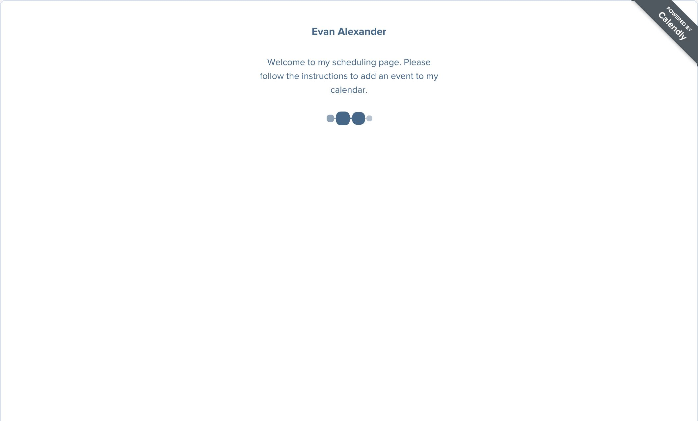
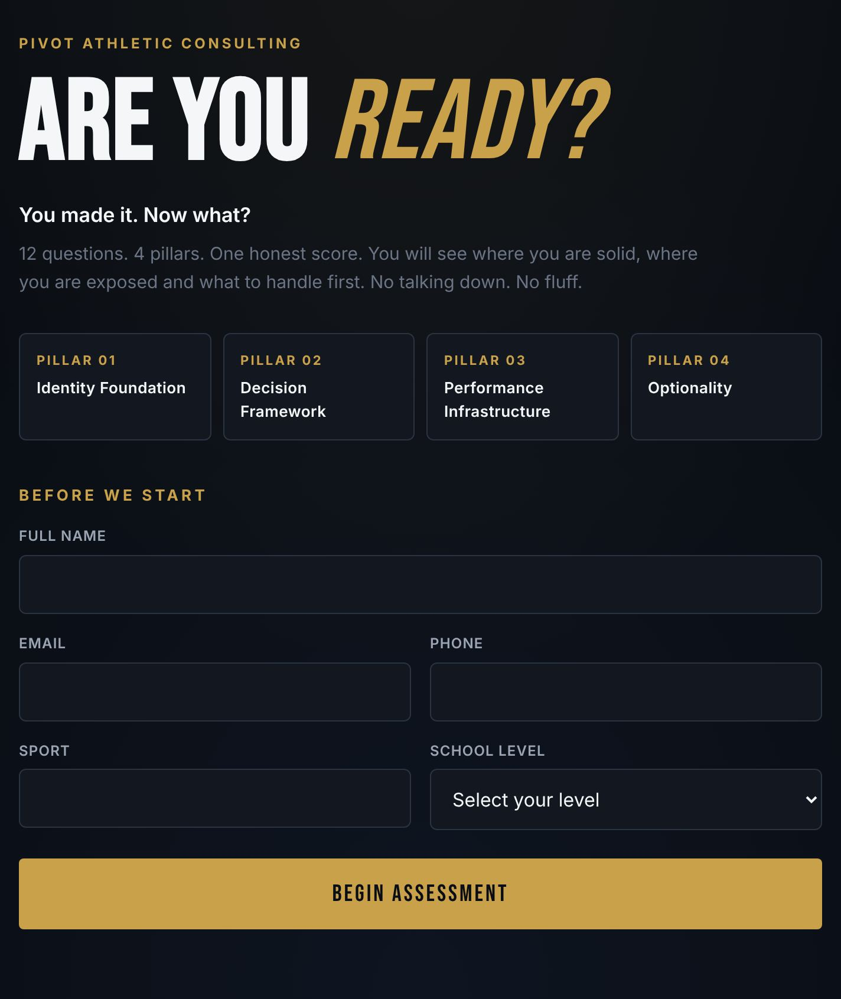

# PivotPAC Site Audit

Run November 6, 2026. Scope: the 11 sitemap pages on pivotpac.com, both assessment sites (assess. and parents.), and Calendly booking. Each was checked on phone (390px), tablet (768px) and desktop (1440px). Testing was read only and no real submissions were made.

This repo is public, so the security findings live only in the private report page. Their IDs are kept so the numbering matches.

## The verdict

The site looks like a firm worth $2,999. Behind the buttons, it loses the people it works hard to attract.

The athlete assessment saves nothing. The contact form and newsletter send nothing, then tell the visitor they did. Every paid "Book" button lands on a calendar with no slot for the thing it promised. Fix those three this week. Then clear the two legal items: no privacy policy, and a Terms page that still calls itself a template.

| Severity | Count | Meaning |
|---|---|---|
| Critical | 5 | Losing leads or money now, or clear legal exposure |
| High | 7 | Costs trust or sales, or creates risk |
| Medium | 17 | Friction with a real cost |
| Low | 15 | Cleanup |

"Flag for counsel" items are screens for your attorney to confirm.

## Scorecard

| Area | Grade | Why |
|---|---|---|
| Lead capture and booking | Fail | C1, C2, C3 |
| Safety and legal | Fail | C4, C5, H3, H4 |
| Clarity | Needs work | H2, M1, M4 |
| Copy | Needs work | H1, H7, M11 |
| Trust and proof | Needs work | H5 |
| UI and UX | Pass | Clean and on brand. M8, M10 |
| Accessibility | Needs work | M8, M9 |
| Performance | Pass | About 420 KB a page, cached |
| SEO and sharing | Pass | Jargon in title tags. M1, M15 |
| Email and domain security | Needs work | See private report |

## Fix these five first

1. Wire the forms and the athlete assessment, then send one test of each. (C1, C2)
2. Point every Book button at a real Calendly event. (C3)
3. Delete the Terms template line and publish a privacy policy. (C4, C5)
4. Rewrite the founder sentence and drop "wealth management." (H1, H3)
5. Pick one name for the free first call and turn on analytics. (H2, H6)

## Critical

**C1. The athlete assessment throws away every lead.** On `assess.pivotpac.com` the send calls for lead data and results are commented out ("Hook for Mailchimp / CRM integration goes here"), so the page makes no network request. Name, email, phone, sport and score all vanish. Fix: reuse the parent assessment's Formspree call, then test.

**C2. The contact form and newsletter send nothing, then say they did.** `NEXT_PUBLIC_FORM_ENDPOINT` was never set in the build. Both forms open the visitor's email app and show "Message sent" or "You're on the list" right away. This hits Contact, every footer newsletter, Apply for the Build, Apply for a seat, all three Request a Proposal buttons and Partner With PAC. Fix: set the endpoint in Vercel, redeploy and test. Show success only after the service confirms receipt.

**C3. Paid offers can't be booked or bought.** Book the Map ($749), Book the Playbook ($2,999) and Book the Pivot ($899) all go to `calendly.com/evanlralexander`. That page lists three free events and none of the paid ones. Fix: send paid buttons to the Fit Session now, and add paid Calendly events later.

**C4. No privacy policy, while collecting data on minors.** `/privacy` returns 404. The forms collect contact details including High School and Middle School levels. The assessments promise "never be sold or shared" while the parent version sends data to Formspree. California's CalOPPA requires a posted policy. Flag for counsel.

**C5. The Terms page says it's a template.** The live page ends with "This page is a general template and is not a substitute for legal advice. Have counsel review it before relying on it." Delete it, get the page reviewed and add a real date. Flag for counsel.

## High

**H1. The founder credential is told four ways.** The FAQ says "received NIL compensation before it was legal," which reads like a confession. Other pages say "compensated in O'Bannon v. NCAA," "O'Bannon era athlete" and "competed in the pre-NIL era." Founder also says O'Bannon "birthed the NIL era," a stretch given Alston and the July 2021 state laws. Use one accurate sentence everywhere.

**H2. Six names for the first step.** Fit Session, Pivot Call (free), NIL Clarity Session ($175), Game Plan session, Book a Call and The Pivot ($899). Keep "Fit Session" and use it everywhere.

**H3. "Wealth management" language.** The home card says "Risk & Wealth Management," the FAQ claims "the intersection of both" advisor and consultant, and the Founder page talks about "models that build lasting wealth." Rename it "Money & Risk Education" and say plainly that PAC is not a registered investment adviser, law firm, CPA firm or athlete agent. Disclose any referral fees. Flag for counsel.

**H4. The Complete Library discount counts free books.** The card says "$171, now $69, save $102," but two of the nine books are free. The seven paid books add up to $133, so the real saving is $64.

**H5. No proof anywhere.** There are no testimonials, school or event names, speaking clips or results. Institutions and Speaking need them most.

**H6. No analytics on any page.** Turn on Vercel Web Analytics and track clicks on the Book buttons.

**H7. Tax and NIL facts are dated or loose.** The $600 1099 line is out of date: the threshold is $2,000 for payments made in 2026 and later under the One Big Beautiful Bill Act. All income is reportable either way. "IRS Section 61" should read IRC Section 61. Self-employment tax runs about 15.3%. The House answer still frames 2025-26 as the current year. The career counseling claim is unconfirmed. Verify all of this with your CPA, date the FAQ and add a disclaimer line.

## Medium

- **M1.** Jargon leads the page. The title tag and hero say "Decision architecture." Lead with plain words instead: "NIL Consulting for Athletes and Parents."
- **M2.** "PAC" reads as political action committee. Lead headlines with "Pivot."
- **M3.** Both assessments require a phone number before question one. Ask the questions first, then name and email to see the score, with phone optional.

  
- **M4.** The NIL Assessment page never says it's free, 12 questions and five minutes, or what you get.
- **M5.** Five home service cards link to `/services/#...` anchors that don't exist.
- **M6.** Institutions says "No intake forms," then sends Request a Proposal to the contact form.
- **M7.** Security item, see the private report.
- **M8.** Small gray text sits at 3.8:1 contrast, and the blue buttons sit at 3.0:1. AA needs 4.5:1. White at 50% or more passes on your navy.

  
- **M9.** On phones, footer links are 18px tall and social icons are 20px. The minimum is 24px.
- **M10.** At phone width, Home runs about 12,400px and Institutions about 12,000px. Home repeats most of Services.
- **M11.** The site copy breaks your own PAC voice audit 63 times, 34 of them on the FAQ.
- **M12.** There are two contact emails: connect@ on the main site and evan@ on the assessments.
- **M13.** Contract and tax guidance has no on-page disclaimer. "What looks fine" reads like a legal opinion, and "deal support" must never mean negotiating for the athlete. Flag for counsel.
- **M14.** `/playbook/success/` shows "purchase confirmed" to anyone and has no download link on the page.
- **M15.** The assessments use a different host, wordmark and font, have no link home and have no social preview tags.
- **M16.** There's "© 2025" in every footer, "Last updated: 2025" on Terms and 2025-26 framing in the FAQ.
- **M17.** Main site inputs are 14px, so iPhone Safari zooms in on tap. Use 16px. Confirm on a real phone.

## Low

- L1. Calendly has default welcome text, the typo "and or" and a `-clone` URL slug.
- L2. Two different things are called "flagship."
- L3. All 11 pages share one social preview image.
- L4. The 404 page uses the homepage title tag.
- L5. The stat counters read as zeros in the page source.
- L6. The Services lists use broken list markup.
- L7. Match the Creighton credential wording to its official name.
- L8. Social links mix brand and personal accounts.
- L9. Security item, see the private report.
- L10. Playbook HQ weighs 1.9 MB, four times any other page.
- L11. The home FAQ leaves half the desktop screen empty, and the football photo's feathered edges look dated.
- L12. One FAQ answer still says "tier" where the site now says "levels."
- L13. Cite a source for the "$0 to $70,000" range.
- L14. The menu files Speaking under Home.
- L15. The Escape key doesn't close the phone menu.

## Copy rewrites

| Where | Now | Try |
|---|---|---|
| Hero eyebrow | Decision architecture for athletes and institutions | NIL and life-after-sport advisory for athletes and families |
| Main CTA | Book Fit Session | Book a Free Fit Session. No pitch. You leave with one clear next step. |
| Founder credential | ...received NIL compensation before it was legal | ...was [paid as part of the O'Bannon v. NCAA likeness settlement]. Confirm against your paperwork. |
| NIL Assessment intro | NIL has so many layered complexities... | Twelve questions. About five minutes. Free. You get a readiness score across four areas and the first thing to fix before money and contracts show up. |
| Service card 05 | Risk & Wealth Management | Money & Risk Education |
| Bundle | $171 $69 Save $102 | $133 value. $69. Save $64. |
| Contact success | Message sent | Got it. Evan reads every message and replies within [two business days]. |
| Speaking hero | ...having a better read on what NIL actually is and how they can better navigate it. | Athletes, parents and coaches walk out knowing what NIL really is and what to do about it on Monday. |

## What wasn't tested

The ebook checkout, the free download email, the parent assessment submit and Calendly booking were all left alone because each one would trigger a real transaction or message. Real iPhone Safari, outbound social links, Google Fonts on the assessments and real-visitor speed data were out of reach from the test environment.
